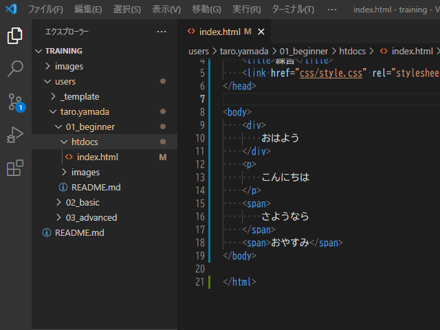

# コーダー編

## はじめに

コーダー編は課題提出がありますので予めご確認下さい。  
つまずいたら質問する前に[トラブルシューティング](./../../troubleshoot/index.md)を参照してください。

- [研修課題提出](https://github.com/epkotsoftware/training-docs/blob/main/submission/README.md#研修課題提出)
- [トラブルシューティング](./../../troubleshoot/index.md)

まずは動画で学習しましょう。

- 動画
  - `3:28` 1_HTML入門
    - <https://www.youtube.com/watch?v=g18PGx1c9eY>
  - `3:12` 2_CSS入門
    - <https://www.youtube.com/watch?v=2tuSsocxFbM>
  - `3:18` 3_パスの書き方
    - <https://www.youtube.com/watch?v=DPKmGdhZysQ>
  - `2:43` 4_現場でよく出るWebの言葉
    - <https://www.youtube.com/watch?v=eVGTr1Wi38Y>
  - `3:22` 5_初めてのHTMLページ
    - <https://www.youtube.com/watch?v=4O9X38fLvl4>
  - VSCode フォルダ・ファイル追加方法  
    

動画を見終わったら、下記入門コース1~3をやっていきましょう。

- 入門1（コーダー 初級）
  - <https://epkotsoftware.github.io/training/cbc_internal/beginner_1.html>
  - <https://epkotsoftware.github.io/training/cbc_internal/beginner_2.html>
  - <https://epkotsoftware.github.io/training/cbc_internal/beginner_3.html>
  - <https://epkotsoftware.github.io/training/cbc_internal/beginner_4.html>
- 入門2（コーダー 中級）
  - <https://epkotsoftware.github.io/training/cbc_internal/beginner_5.html>  
  - <https://epkotsoftware.github.io/training/cbc_internal/beginner_6.html>
  - <https://epkotsoftware.github.io/training/cbc_internal/beginner_7.html>
- 入門3（コーダー 上級）
  - <https://epkotsoftware.github.io/training/cbc_internal/beginner_8.html>

## 課題
ここまで学習した知識をもとに、自由にページを作成しましょう。ただし、**要件や提出時のチェックリストは厳守**すること。
作業日数をより重視します。**1日で出来る範囲で**、自由にページを作成しましょう。
内容自体は採点に影響しませんので、思いつかなければ「実践を踏まえたコーディング」で作ったページのレイアウト変更でもOKです。  
課題提出についてはGitHubで行います。

- 要件
  - 対応ブラウザ
    - Google Chrome
  - 表示
    - 自分のユーザーディレクトリの「`01_beginner/htdocs/index.html`」をブラウザで開くと、作成したページが見れる。
    - 横幅:`950px` と `1920px` で表示が崩れないようにする（確認方法は[横幅を指定した確認方法](./../../../public/t/google-chrome/index.md#使用)を参照）
      - `950px` で横スクロールができないこと
      - `950px` で文字・画像が切れていないこと
      - `1920px` でコンテンツが中央寄せになっていること
  - その他
    - 自分のユーザーディレクトリの「`01_beginner/htdocs/`」ディレクトリ内にHTML・CSSが入っていること
- [フリー素材](./../../../free-materials/index.md)

## 課題提出

以下を参照してください。**必ずすべてのチェック項目を確認してから、コミットすること**

- [研修課題提出](https://github.com/epkotsoftware/training-docs/blob/main/submission/README.md#研修課題提出)

## 研修進捗資料の更新

課題提出した日付で「研修進捗」資料の更新をお願いします。

- [研修進捗](https://github.com/epkotsoftware/training-docs/blob/main/training/progress/README.md)

## ここから先は廃止されます。かつての資料です。緊急用に残してあるだけですので、指示がない限り学習しないでください)
- *2026/8まで利用されていた資料へのリンクです。古い情報なので、学習しないこと。* ToDo: このセクションは本年中に廃止します。

- 動画を見終わったら、[CBC](https://cbc-study.com/)の入門コースをやっていきましょう。
- - 入門1（コーダー 初級）
  - <https://cbc-study.com/training/beginner/page1>
  - <https://cbc-study.com/training/beginner/page2>
  - <https://cbc-study.com/training/beginner/page3>
  - <https://cbc-study.com/training/beginner/page4>
- 入門2（コーダー 中級）
  - <https://cbc-study.com/training/beginner/page5>
  - <https://cbc-study.com/training/beginner/page6>
  - <https://cbc-study.com/training/beginner/page7>
- 入門3（コーダー 上級）
  - <https://cbc-study.com/training/beginner/page8>
  - **注意: [「8. 枠が完成！」](https://cbc-study.com/training/beginner/page8#pl-12) の「このようになります。」のリンクをクリックすると誤ったサンプルが出てきますので無視してください。**

2022/6/15でブラウザの「`Internet Explorer(IE)`」が廃止されることにより  
CSSの「`grid-template`」が、ほぼ全てのブラウザでサポートされます。  
今後、使われる事が増えそうなので以下も覚えておきましょう。

- 動画
  - `4:25` 6_グリッドでレイアウトを組む
    - <https://www.youtube.com/watch?v=mws5joZq4Oo>
- 
