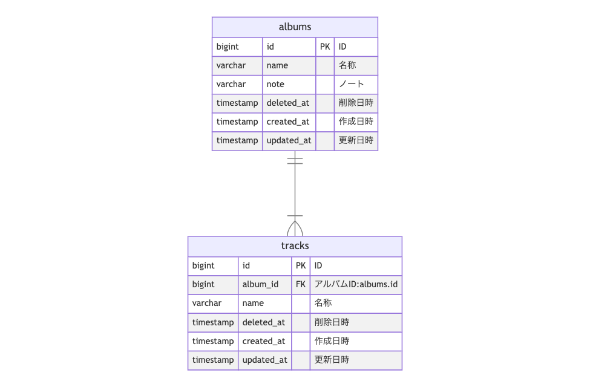
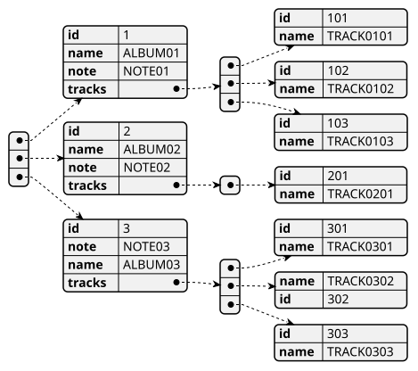

# プログラミング実践

## はじめに

本研修では現場での実装(プログラミング)を想定し  
プログラミングの基礎知識、検索力等を見ていきます。  
よって、わからない用語については検索することは許可します。  

## 休憩

- 1時間で10分休憩をとりましょう。

## 禁止事項

現場に入っていることを想定しているのと、検索力・読解力をみるため  
以下を禁止します。  

- ネット環境で閲覧出来ない情報
  - ノート・メモの閲覧（現場に持ち込めないケースもある）
  - 書籍の閲覧
- サービス
  - ChatGPT等のAIの利用（セキュリティの観点から、現場では利用できないケースもある）
  - ログインが必要なサービスの利用を禁止（現場では、サービスへのログインが監視されているケースもある）
    → Qiita・Zenn・個人ブログ等、一般公開しているようなものであればOK
  - メールの閲覧（セキュリティの観点から、メール閲覧は禁止されている事が多い、就業規則では個人的なメール等の閲覧も禁止されている）
- 動画の閲覧（隣の席にプロパーがいる等、現場で動画を閲覧する事はなかなかできないケースもある）

## 検索においてAIが回答することへの対応

2026年現在、グーグルで検索すると、「概要」としてGeminiが検索結果を要約しますが、これはAIの利用に該当します。
また、概要欄のチャット欄にそのまま入力することも可能ですが、これはAIの利用そのものです。
便利な機能ですが、今回の1on1の回答をそのまま掲載してしまうケースがあり、正しい評価ができなくなります。
以下の方法で回避することをおすすめします。
回避せずAIの話した内容をもとに回答した結果、不当に高い評価をすることになり、ご自身に見合わない案件を紹介され、トラブルの原因になりますのでご注意ください。

- URLに　chrome://settings/searchEngines　と入力する
- 「サイト内検索」の右にある「追加」をクリックする
- 以下のとおり入力する

| 項目 | 設定値 |
|---|---|
| 名前 | Google（AIなし） |
| ショートカット | `google-noai` |
| URL | `https://www.google.com/search?q=%s&udm=14` |

- 「検索エンジン」をGoogle（AIなし）で既定にする。「… 」をクリックすると変更可能


## 参考ページ

- 研修ページ
  - [PHPプログラミング編](./../../public/t/php/index.md)
    - 【PHP】初心者向けチートシート
      - <https://zenn.dev/seiya0/articles/tech-php-cheat-sheet>
  - ER図を簡単に作成してみよう【DB設計】【Mermaid】
    - <https://zenn.dev/seiya0/articles/tech-mermaid-erd>
  - [ファイル編](./../../public/t/file/index.md)

## 課題1

指定した3つの値が完全一致した場合は true  
それ以外の場合は false を返すHelperクラス・メソッドを作成してください。  
（入社試験と同等の内容）  

| 終了目安 |
| :---: |
| 10分〜2時間 |

### kadai01.php

Helperクラス・メソッドの使用例です。  
動作確認にご利用ください。  

- ファイル名: `kadai01.php`
- ファイル内容: 以下を貼り付ける  ※ **確認用のファイルのため、内容は変更しないこと。**  
    12行目までのコードを読み動作するようにしましょう。  

```php
<?php
error_reporting(-1); // 全ての PHP エラーを表示する

require_once(__DIR__ . '/app/Helper.php');

use App\Helper;

ob_start(); // 出力バッファリング開始（echo、var_dumpした内容を内部バッファに保存）

// 結果が true のパターン
$actualValuesForTrueCase = [];
$actualValuesForTrueCase[] = Helper::same(1, 1, 1);
$actualValuesForTrueCase[] = Helper::same(2, 2, 2);
$actualValuesForTrueCase[] = Helper::same('a', 'a', 'a');

// 結果が false のパターン
$actualValuesForFalseCase = [];
$actualValuesForFalseCase[] = Helper::same(1, 1, 2);
$actualValuesForFalseCase[] = Helper::same(1, 2, 1);
$actualValuesForFalseCase[] = Helper::same(2, 1, 1);
$actualValuesForFalseCase[] = Helper::same(2, 2, '2');
$actualValuesForFalseCase[] = Helper::same(2, '2', 2);
$actualValuesForFalseCase[] = Helper::same('2', 2, 2);
$actualValuesForFalseCase[] = Helper::same('b', 'a', 'a');
$actualValuesForFalseCase[] = Helper::same('a', 'b', 'a');
$actualValuesForFalseCase[] = Helper::same('a', 'a', 'b');

$outContents = ob_get_clean(); // 出力バッファ取得・出力バッファ消去・出力バッファリング停止
?>
<!-- ↓↓↓HTML -->
<!DOCTYPE html>
<html lang="ja">

<head>
    <meta charset="UTF-8" />
    <meta name="viewport" content="width=device-width, initial-scale=1.0" />
    <title>課題01</title>
    <style>
        pre {
            border: 1px solid black;
            padding: 6px;
        }
    </style>
</head>

<body>
    <h1>課題01</h1>
    <?php if (!empty($outContents)) { ?>
    <section>
        <h2>不正出力</h2>
        <p>メソッド内で不正な出力を検知しました（var_dump、echo等）。</p>
        <pre><?= $outContents ?></pre>
    </section>
    <?php } ?>
    <section>
        <h2>trueパターン</h2>
        <p>結果が全て bool(true) になっていること</p>
        <pre><?php
            foreach ($actualValuesForTrueCase as $actualValue) {
                var_dump($actualValue);
            }
        ?></pre>
    </section>
    <section>
        <h2>falseパターン</h2>
        <p>結果が全て bool(false) になっていること</p>
        <pre><?php
            foreach ($actualValuesForFalseCase as $actualValue) {
                var_dump($actualValue);
            }
        ?></pre>
    </section>
</body>

</html>
```

## 課題2

レコードを格納した配列(array)をTSV(string)に変換するクラス・メソッドを作成してください。  

| 終了目安 |
| :---: |
| 1時間〜5時間 |

### 仕様

#### ER図

テーブルの関連図です。

- [Mermaid](https://mermaid.live/edit#pako:eNrNkkFLwzAYhv9KyHnzB_RchCGC4LUwvjXftmDTjjQVpOtluUxB6UkZehBRPHjZwaP-mmjFf2HSdupgiN78ckreJwk8vDkNE4bUoyh9DiMJIoiJHYgGmUjJdNrtTnOiJIQHKfFIQO2K15C82bkZ8BGPFeGM7O1YtOc7eBUeggzHIEkMAm34Wp6-3S83AolygNFnRj8ZPf_OKC4wVSAmhGGEClkflHvs-OR9cVtd3FWL2WY8lAif-MvzVTUvf8KzCfvCq8vH6ny5jhcrC62a31pow9pd3yLbDjGzG6MfjC6Nvu75XiN2i7M_6ftPamiHCpQCOLPNqtUEVI1RYEBdhxgOIYuUu1BYFDKV7B_FIfWUzLBDmx_aOlJvCFFqT5Fxlcjdpq11aYsPc7IAMQ)  
    

#### TSV

TSVの仕様です。

- TSVのヘッダー行は出力対象外
- 改行コードは「LF」
- 出力イメージは[出力例](#出力例)を参照。

| No. | TSVカラム | テーブルカラム | 備考 |
| :---: | --- | --- | --- |
| 1 | id | albums.id |  |
| 2 | name | albums.name |  |
| 3 | note | albums.note |  |
| 4 | track_names | tracks.name | 「,」区切りで連結して出力する |

#### テーブルレコード

テーブルから取得した配列の仕様です。

- 連想配列内の順番は保障しない。
- レコード配列のイメージ
  - [PlantUML](https://www.plantuml.com/plantuml/umla/bP8_3u903CNt-nHDvnkWtPX0u-GV4uEJOI32e4P8u3R2T_TomKEX9Dg9zBqytY-zk3LvO-vjNQcB0ZkTWc7mLc04eHuNLVuixGgJtUgy3qByb6hZfCCntNmhficlZzPgBjzFDyG7eHw3qrEotWPsXxsMtIIuQT7DWfknz-RCVVLQ88S8Q8eEdfrcxF269m4U97htYn4VV4Ux_BaZB_PWNAxF_tHagICBDvfx23Nu59hwlS9Ild0dbQcuh0htMby0)  
    

### kadai02.php

クラス・メソッドの使用例です。  
動作確認にご利用ください。  

- ファイル名: `kadai02.php`
- ファイル内容: 以下を貼り付ける  ※ **確認用のファイルのため、内容は変更しないこと。**  
    41行目までのコードを読み動作するようにしましょう。  

```php
<?php
error_reporting(-1); // 全ての PHP エラーを表示する

require_once(__DIR__ . '/app/AlbumHelper.php');

// 多次元配列
$albums = [
    [
        "id" => 1,
        "name" => "ALBUM01",
        "note" => "NOTE01",
        "tracks" => [
            ["id" => 101, "name" => "TRACK0101"],
            ["id" => 102, "name" => "TRACK0102"],
            ["id" => 103, "name" => "TRACK0103"],
        ],
    ],
    [
        "id" => 2,
        "name" => "ALBUM02",
        "note" => "NOTE02",
        "tracks" => [
            ["id" => 201, "name" => "TRACK0201"],
        ],
    ],
    [
        "id" => 3,
        "note" => "NOTE03",
        "name" => "ALBUM03",
        "tracks" => [
            ["id" => 301, "name" => "TRACK0301"],
            ["name" => "TRACK0302", "id" => 302],
            ["id" => 303, "name" => "TRACK0303"],
        ],
    ],
];

ob_start(); // 出力バッファリング開始（echo、var_dumpした内容を内部バッファに保存）

// 対象メソッドの実行
$result = \App\AlbumHelper::albumsToTsvString($albums);

$outContents = ob_get_clean(); // 出力バッファ取得・出力バッファ消去・出力バッファリング停止

// 戻り値エラー判定（$isError が true の場合にエラー）
$isError = !is_string($result) || empty($result);

// TSVファイルダウンロード判定（tsvパラメータが「true」になっているか）
if (($_REQUEST['tsv'] ?? '') === 'true') {
    if ($isError) {
        // エラー
        http_response_code(500);
        exit(1); // ここで処理終了
    }

    // TSVファイルダウンロード
    header('Content-type: text/tab-separated-values');
    header("Content-Disposition: attachment;filename=kadai02.tsv");
    echo $result;
    exit(0); // ここで処理終了
}

// 画面表示処理
$newLine = '-';
$urlTsvDownload = $_SERVER['PHP_SELF'] . '?tsv=true';
if ($isError) {
    $urlTsvDownload = null;
    // var_dumpの内容を文字列として取得し、$result に格納
    ob_start();
    var_dump($result);
    $result = "エラー: 戻り値が不正です。\r\n\r\n" . ob_get_clean();
} else {
    // 改行コードチェック
    $crlfCount = substr_count($result, "\r\n");
    $lfCount = substr_count($result, "\n");
    if (0 < $crlfCount) {
        $newLine = ($crlfCount === $lfCount) ? 'CRLF' : 'CRLF と LFが混在しています。';
    } elseif(0 < $lfCount) {
        $newLine = 'LF';
    }
}

?>
<!-- ↓↓↓HTML -->
<!DOCTYPE html>
<html lang="ja">

<head>
    <meta charset="UTF-8" />
    <meta name="viewport" content="width=device-width, initial-scale=1.0" />
    <title>課題02</title>
    <style>
        pre {
            border: 1px solid black;
            padding: 6px;
        }

        /** Bootstrapっぽいボタン */
        a {
            padding: 6px 12px;
            display: inline-block;
            font-weight: 400;
            line-height: 1.5;
            color: #fff;
            text-align: center;
            text-decoration: none;
            vertical-align: middle;
            cursor: pointer;
            -webkit-user-select: none;
            -moz-user-select: none;
            user-select: none;
            border-radius: 0.375rem;
            background-color: #0d6efd;
        }
    </style>
</head>

<body>
    <h1>課題02</h1>
    <?php if (!empty($outContents)) { ?>
    <section>
        <h2>不正出力</h2>
        <p>メソッド内で不正な出力を検知しました（var_dump、echo等）。</p>
        <pre><?= $outContents ?></pre>
    </section>
    <?php } ?>

    <section>
        <h2>TSV出力結果</h2>
        <p>改行コード: <?= htmlspecialchars($newLine) ?></p>
        <pre><?= htmlspecialchars($result) ?></pre>
        <?php if (!empty($urlTsvDownload)) { ?>
            <a href="<?= $urlTsvDownload ?>">TSVダウンロード</a>
        <?php } ?>
    </section>
</body>

</html>
```

### 出力例

```tsv
1	ALBUM01	NOTE01	TRACK0101,TRACK0102,TRACK0103
2	ALBUM02	NOTE02	TRACK0201
3	ALBUM03	NOTE03	TRACK0301,TRACK0302,TRACK0303
```

## 課題3

課題2の仕様変更をしましょう。  
仕様変更内容は以下です。

| 項目 | 変更前 | 変更後 |
| --- | --- | --- |
| TSVヘッダー行 | なし | あり |
| TSV改行コード | LF | CRLF |

| 終了目安 |
| :---: |
| 2分〜30分 |

## 読解力・プログラミング力を身につける

更に基礎の理解を深めるには、「独習PHP」という本を使って学習を勧めています。  

- `PHP8技術者認定初級試験`
  - <https://www.phpexam.jp/summary>
- `独習PHP 第4版`
  - <https://www.amazon.co.jp/dp/4798168491>

基礎があった上で、実際にWebシステムを作り  
プログラミング力を身につけていくのが良いです。  

## 説明力を身につける

アウトプットしましょう。
研修と並行して、簡単なアプリ開発をしてみるのもよいです。
実際の仕事は勉強ではなくて開発や設計、あるいはテストの実施など、実際に手を動かすことです。
勉強だけではスキルは上がらないため、簡単なものてよいので手を動かして設計したりコードを書きましょう。
※このあと説明する面談対策との学習バランスは気を付けてください。

以下は実施例です。

| 手順 | 工程 | 目安日数 | 実施内容 | ポイント・備考 |
|---|---|---|---|---|
| 1 | 要件整理 | 1~3日 | 作りたいものをA4用紙1枚程度にまとめる。 | 書式は自由。「自分がほしいもの」を重視する。趣味に関するものなら業務調査の手間を省ける。 |
| 2 | 設計 | 1〜5日 | 要件をもとに設計書を作成する。 | AIに必要な設計の種類を相談する。最低限、画面設計・DB設計・状態遷移図があるとよい。最初のうちは3〜4画面程度を目安にする。 |
| 3 | 開発 | 機能や画面ごとに5日程度 | 設計書をもとに開発を進める。 | 1週間単位で完成できる範囲を決める。1週間ごとに成果を確認し、次の開発内容を決める。小さな完成を積み重ね、段階的に機能を増やす。 |

必須ではありませんが、報告会等で発表して、フィードバックをもらいましょう。
他人に教えることが、自身のスキルアップや説明力の向上に役立ちます。  


自分の言葉で勉強したことをまとめたり、以下のサービスを活用して情報発信したりすると良いでしょう。

- `Qiita`
  - <https://qiita.com/>
- `Zenn｜エンジニアのための情報共有コミュニティ`
  - <https://zenn.dev/>

## 今後の流れ

研修は引き続きやっていきますが  
並行して、以下を進めていきます。

- スキルシート作成
  - 社長の方でスキルシートを作成します。  
    不備等がないか確認して下さい。
  - 作戦会議までに、面談対策資料や内部開発案件の内容には  
    目を通しておきましょう。
    - [面談準備](https://github.com/epkotsoftware/training-docs/blob/main/interview/README.md)
- 作戦会議
  - 社長・営業を含め会議を行い  
    スキルシートの修正を行います。
- 営業開始
  - 営業を開始し、案件情報を持ってきます。
- 面談
- 参画

## キャリアパス

- [キャリアパス](./../../career-paths/index.md)
